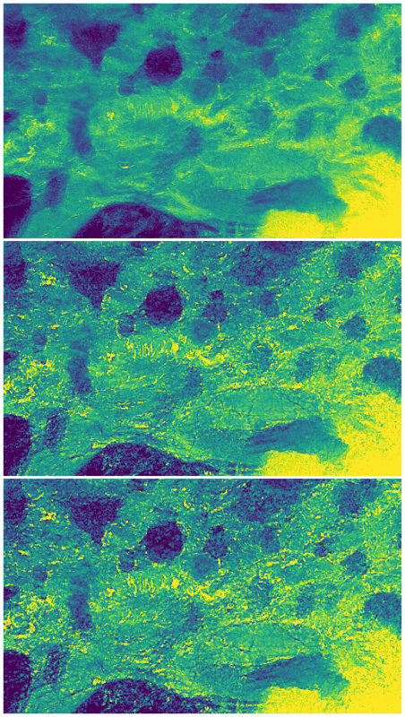

---
hide:
  - navigation
  - toc
---

H2020 ERC Consolidator Grant project

# Scattering-based X-ray Imaging and Tomography

By the **Optimal Imaging and Tomography Group** · Lead: P. Thibault

[Explore our research](research.md){ .md-button .md-button--primary }
[Meet the team](our-team.md){ .md-button }

## X-ray vision for science

The aim of the Optimal Imaging and Tomography Group (OptImaTo) is to push the limits of X-ray imaging techniques towards ever higher resolution and higher contrast sensitivity. In particular, we look at means of using coherence and the related interference and diffraction phenomena as tools to efficiently encode nanometer-scale information from samples of interest. Decoding this information requires sophisticated algorithmic techniques, which are a specialty of our group.

The two main techniques applied and investigated in our group are *X-ray ptychography* and *speckle-based X-ray imaging.*

<figure markdown>

<figcaption>Study of X-ray propagation effects on a fossilized dinosaur tooth</figcaption>
</figure>

## News and events

2023-05-16

### [Contribution to Optica Biophotonics Congress](news/posts/elementor-1679.md)

2023-03-26

### [One open PhD position &#8211; Join the group!](news/posts/phd-position-available-2.md)

2023-02-22

### [New paper about improved UMPA version published in Optics Express](news/posts/new-umpa-published.md)

2023-01-03

### [Ptychography reconstruction package &#8220;ptypy&#8221; now available online](news/posts/ptychography-reconstruction-package-ptypy-now-online.md)

[All news and events →](news/index.md)

## Research partners

The S-BaXIT project is done in collaboration with **Elettra Sincrotrone Trieste**, the only synchrotron radiation facility in Italy. Elettra hosts the OptImaTo group and its laboratory.

## Publications

### Featured on the original homepage

F. De Marco, S. Savatović, R. Smith, V. Di Trapani, M. Margini, G. Lautizi and P. Thibault, [High-speed processing of X-ray wavefront marking data with the Unified Modulated Pattern Analysis (UMPA) model](https://doi.org/10.1364/OE.474794), **Optics Express** (2023)

V. Di Trapani, L. Brombal, F. De Marco, D. Dreossi and P. Thibault, [Unified Modulation Pattern Analysis (UMPA) algorithm for 1D sensitive X-ray phase contrast imaging techniques](https://doi.org/10.1088/1748-0221/18/01/C01059), **Journal of Instrumentation** (2023)

[Go to publications →](publications.md)

## Meet the team

The S-BaXIT project is carried out by Prof. Thibault’s group, **OptImaTo**, devoted to the development and application of novel X-ray imaging methods. Have a look at our profiles!

[Go to People →](our-team.md)

## X-ray imaging and tomography

We are always ready to take on new challenges, with new collaborators and ideas of systems and samples to image. We are also looking for industrial partners.

<video controls muted loop playsinline preload="metadata" src="assets/videos/starfish-3d-rendering.mp4" aria-label="Three-dimensional X-ray rendering of a starfish"></video>

[Contact us](contacts.md){ .md-button }
[Job offers](jobs.md){ .md-button }
