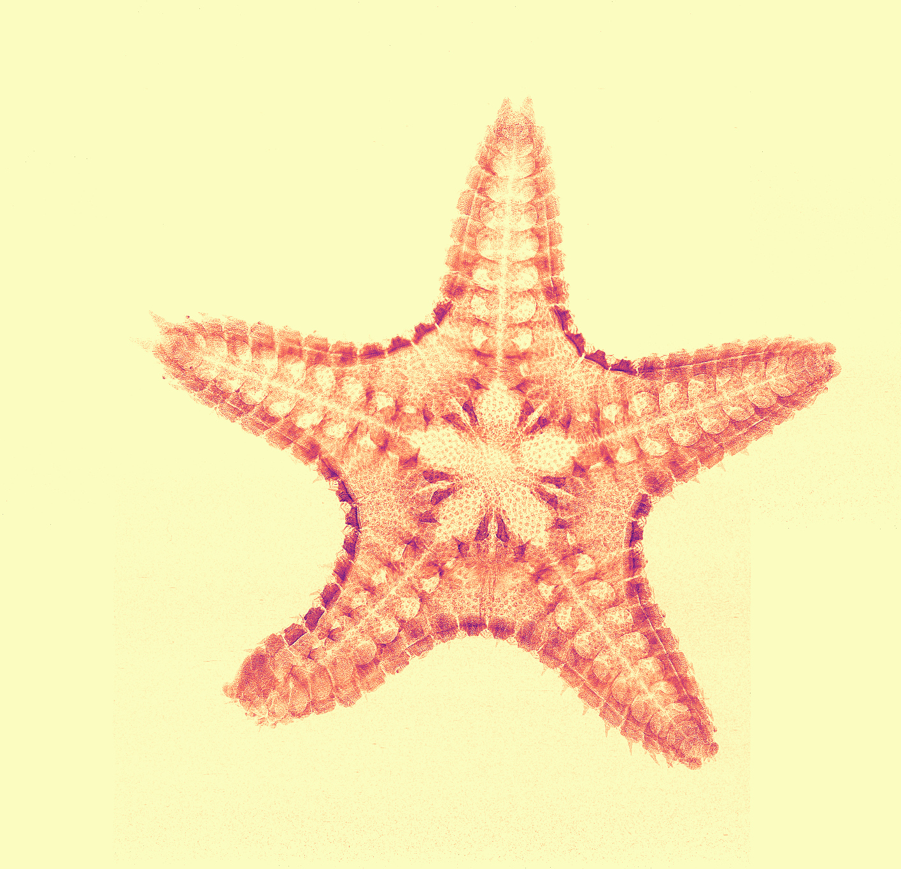

# A starfish in the news

A starfish in the news: our group has joined forces with with Dr. Irene Zanette (Elettra) and Ms. Christina Wood (U. of Southampton) in a project to characterize  sea stars of the species *Ctenodiscus crispatus* from the Norwegian and Barents seas. The objective is to study how the growth and reproduction of these small stars is affected by climate change.

<!-- more -->

 

Even if our results are still only preliminary, the beautiful small stars have already attracted the attention of the media. Some of the news coverage:

- [Ansa (17/12/2020)](https://www.ansa.it/canale_scienza_tecnica/notizie/tecnologie/2020/12/17/in-una-stella-marina-le-spie-dei-cambiamenti-climatici-_36efb45d-d258-4b7a-8685-591c53f3096e.html)
- [Trieste Prima (18/12/2020)](https://www.triesteprima.it/cronaca/stelle-marine-spie-dei-cambiamenti-climatici-innovativo-progetto-dall-universita-di-trieste.html)
- [La Repubblica (04/01/2021)](https://www.repubblica.it/cronaca/2021/01/04/news/nelle_stelle_marine_il_segreto_del_surriscaldamento_globale-281096395/)

[Back to all news](../index.md)
