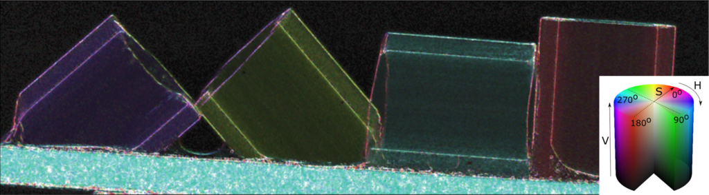

# New publication about speckle-based imaging for directional dark-field

The publication “X-ray directional dark-field imaging using *Unified Modulated Pattern Analysis*” by Ronan Smith *et al.* was published at PLOS ONE on August 29, 2022 ([link here](https://dx.doi.org/10.1371/journal.pone.0273315), open access, CC BY 4.0). The paper demonstrates how directional small-angle scattering information can be extracted from the anisotropic blur of a speckle pattern. It shows, on the example of a carbon-fibre composite material, that the orientation of the (otherwise invisible) carbon fibres can be inferred from the anisotropic blur of the speckle pattern. The method may find application in non-destructive testing of carbon-fiber composites, since structural damage in such materials is difficult to detect with conventional radiography.

<!-- more -->

The developed signal extraction method is an add-on to the UMPA (“Unified Modulated Pattern Analysis”) model for processing speckle-based data. UMPA works by comparing speckle patterns measured with and without an object in the beam, thus characterizing how it distorts the pattern. While previous approaches only modeled an overall reduction of visibility due to scatterers with a linear scaling factor, this new approach characterizes the effect more physically accurately, namely by convolution of the intensities with a two-dimensional, anisotropic Gaussian blur kernel.

The directional dark-field add-on is available at [GitHub: optimato/UMPA_directional_dark_field](https://github.com/optimato/UMPA_directional_dark_field). It requires a C++/Cython-based implementation of UMPA itself to run, which will be the focus of an upcoming publication, and is also available at [GitHub: optimato/UMPA](https://github.com/optimato/UMPA).

[Back to all news](../index.md)
