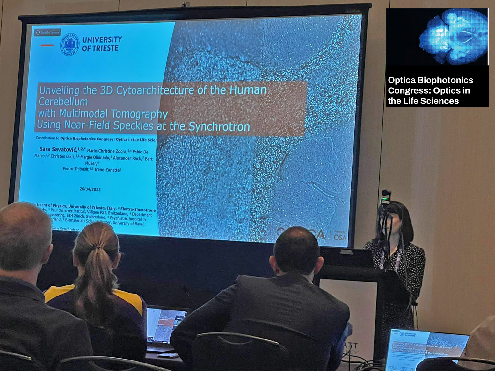

# Contribution to Optica Biophotonics Congress

Sara had the opportunity to present our most recent results on speckle-based multimodal tomography of the human cerebellum at the [Optica Biophotonics Congress](https://www.optica.org/en-us/events/congress/biophotonics_congress/) that took place on 24-27 April 2023 in Vancouver!

<!-- more -->

🧠🔬 Three-dimensional visualization of human cerebellar tissue, down to cellular levels, has the potential to uncover morphological alterations that may be associated with neurological diseases. Speckle-based imaging at the synchrotron can yield multivolumetric data that can help identifying such changes.

[Back to all news](../index.md)
