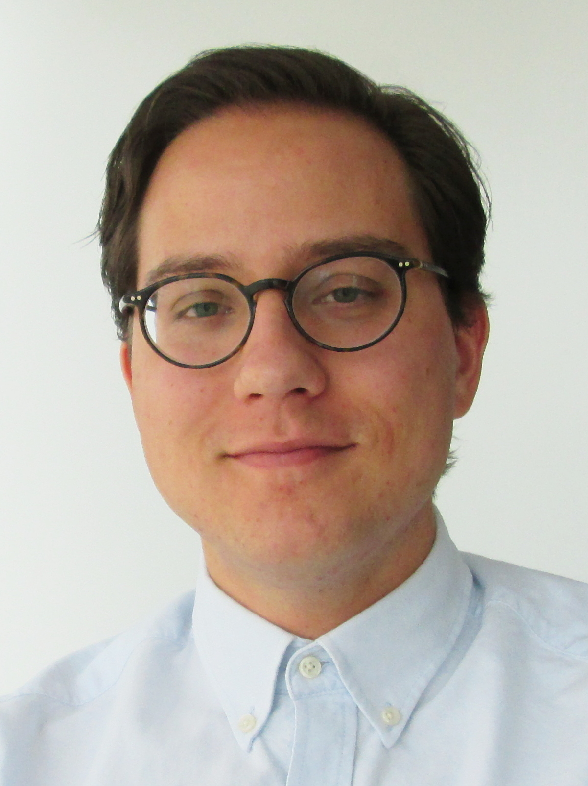

# Fabio joins the team!

Welcome to soon-to-be Doctor Fabio De Marco, who joins the team from today as a post-doctoral researcher. Fabio did his PhD work at the Technical University of Munich ([Pfeiffer group](https://www.ph.nat.tum.de/en/e17/home/)) on grating-based X-ray imaging techniques. He will be working on the integration of scattering phenomena in speckle-based X-ray imaging and near-field ptychography.

<!-- more -->

[Back to all news](../index.md)
