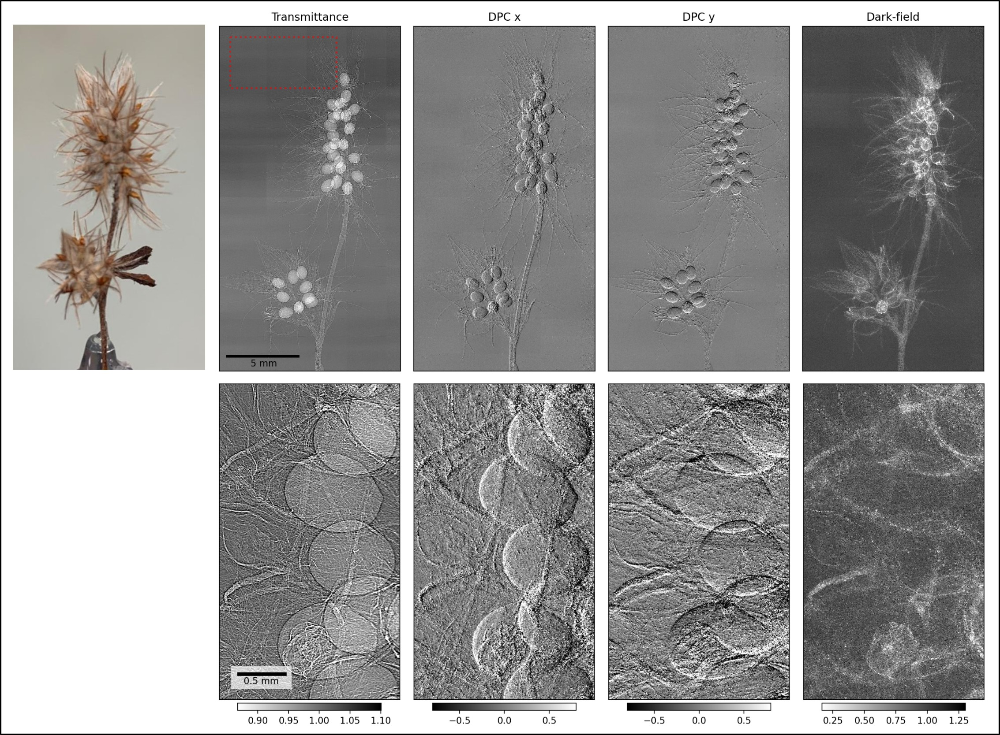

# Faster, improved version of UMPA now available on GitHub!

We have released a new, improved implementation of UMPA on GitHub! Due to its implementation using C++ and Cython, it is about 120 times faster than the previous Python-based implementation, which is especially useful for large tomographic datasets. Furthermore, we have introduced new features, most prominently “sample-stepping”, which allows displacing the sample instead of the diffuser between acquisitions. This enables a faster acquisition of samples much larger than the field of view. The software is available at: <https://github.com/optimato/UMPA> and <https://doi.org/10.5281/zenodo.6984740>.

<!-- more -->

An accompanying publication is in review. However, you can already read the preprint at: <https://arxiv.org/abs/2211.01375>.

[Back to all news](../index.md)
