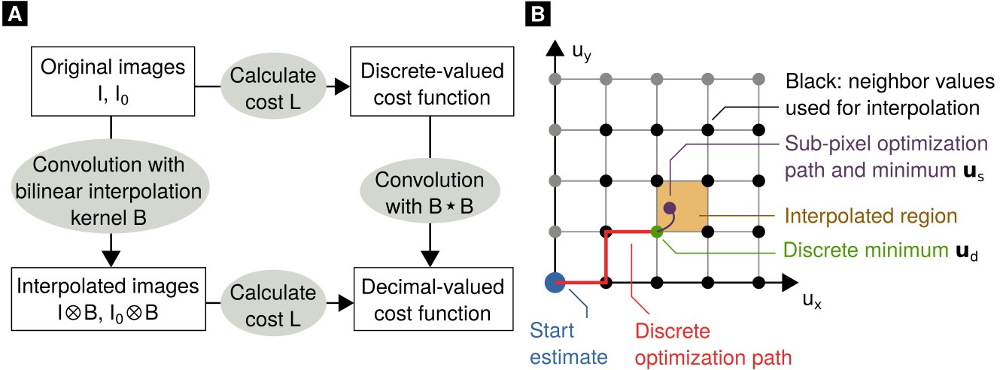

# New paper about improved UMPA version published in Optics Express

UMPA (short for “Unified Modulated Pattern Analysis”) is a technique for extracting sample information from X-ray images acquired with e.g., speckle-based or grating-based techniques.

<!-- more -->

Our work on a faster, improved version of UMPA (see also our [previous post](new-umpa-preprint-and-github.md) about the preprint) has recently been published in Optics Express[^1]! The paper is available [here](https://doi.org/10.1364/OE.474794) (open access), and the software itself can be found on [GitHub](https://github.com/optimato/UMPA) and [Zenodo](https://doi.org/10.5281/zenodo.6984740). Find out more about our research [here](../../research.md).

[Back to all news](../index.md)

[^1]: F. De Marco, S. Savatović, R. Smith, V. Di Trapani, M. Margini, G. Lautizi and P. Thibault, [High-speed processing of X-ray wavefront marking data with the Unified Modulated Pattern Analysis (UMPA) model](https://doi.org/10.1364/OE.474794), **Optics Express** (2023) |
