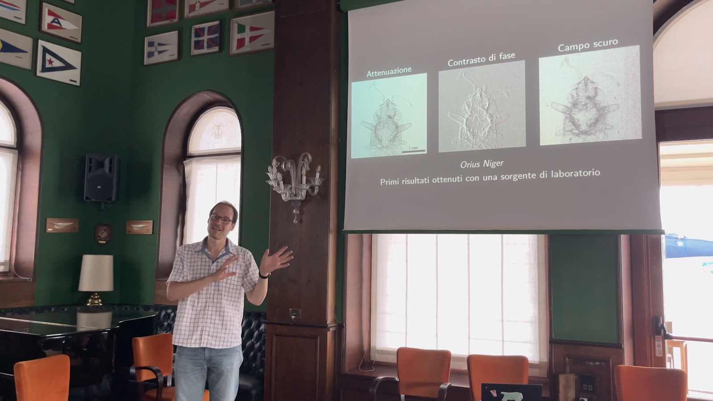

# Outreach talk at Trieste’s Adriaco

Prof. Thibault was invited by the Regional division of the association [Marevivo](https://marevivo.it) to give an outreach talk about [our recent work](/news/a-starfish-in-the-news/) using X-rays to help the study of starfish specimens from the Norwegian and Barents seas. The talk was an opportunity to highlight two momentous 125th anniversaries: the discovery of X-rays by Wilhelm Conrad Röntgen, and the discovery of the greenhouse effect by Svante Arrhenius.

<!-- more -->

[Back to all news](../index.md)
