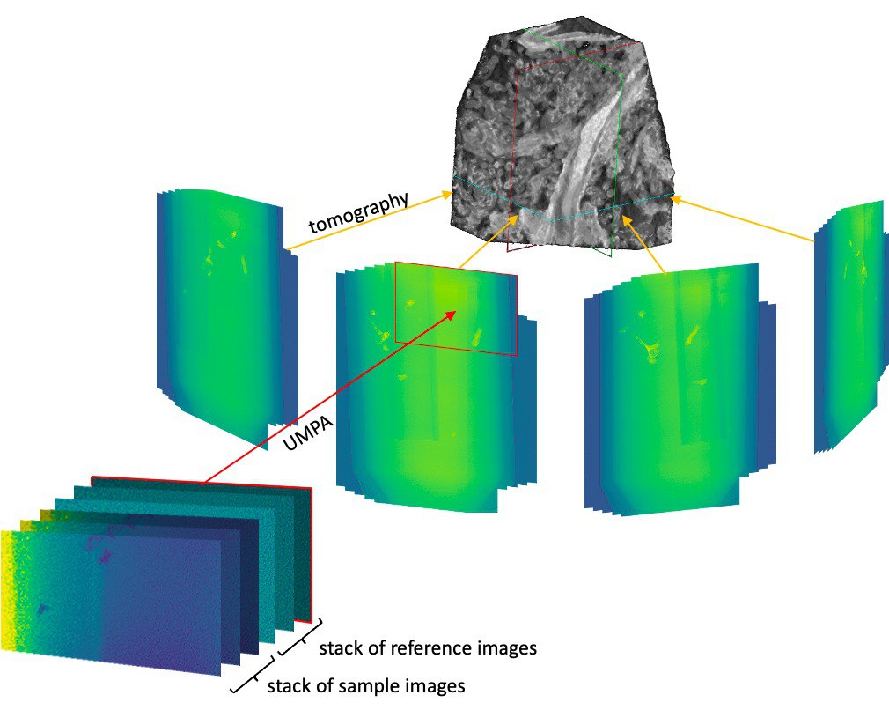

# One open PhD position – Join the group!

[One new PhD position is now available in our group](../../assets/documents/phd-project-thibault-2023.pdf). The project starts in November 2023 and is entitled “Ultra-fast multimodal X-ray microCT”. The successful candidate will join the [OptImaTo team](../../our-team.md) to help push the limits of multimodal X-ray microCT. The project has a good dose of computing, but experimental work will also be needed to test and apply the newly developed methods. Find out more about our research [here](../../research.md).

<!-- more -->

[Back to all news](../index.md)
