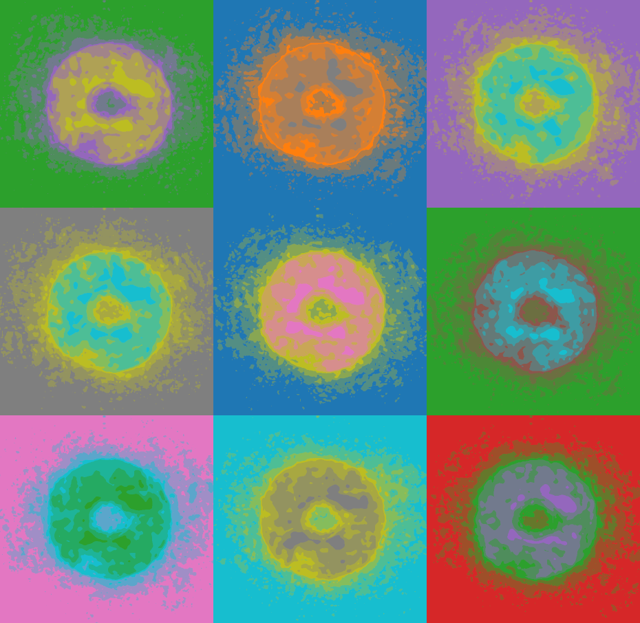

# Physics Today article on ptychography

[In this month’s issue of Physics Today](https://doi.org/10.1063/PT.3.4835), an article written by Prof. Thibault and long-time collaborator Manuel Guizar-Sicairos (Paul Scherrer Institut, Swizerland) presents a review of ptychography. In only 15 years, this imaging technique has become the method offering the highest resolution in 2d and 3d for both X-ray and electron microscopy.

<!-- more -->

The development of ptychography is an important part of the S-BaXIT project.

[Back to all news](../index.md)
