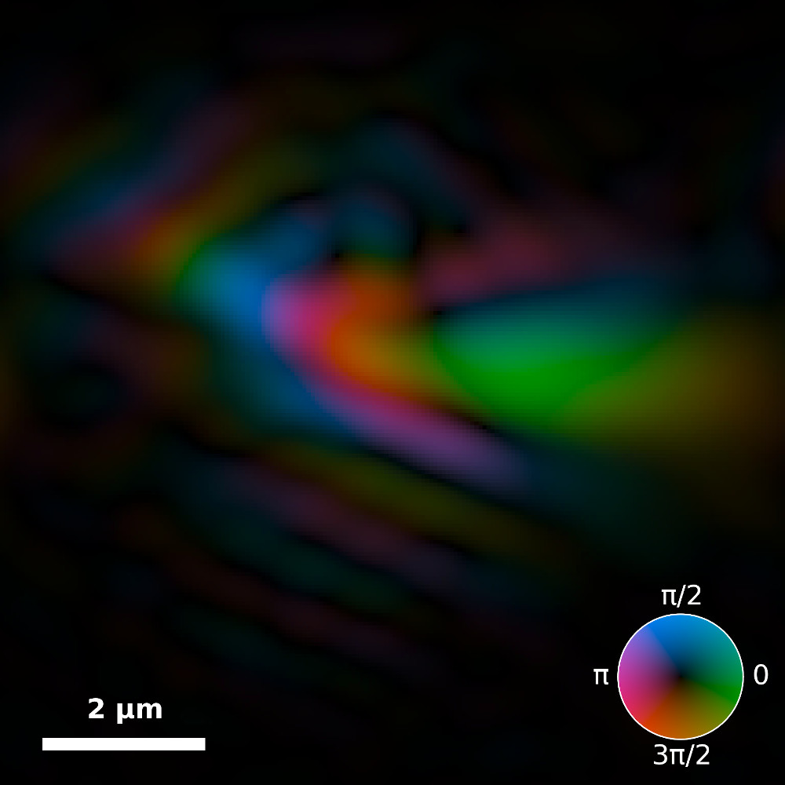

# Ptychography for XFEL pulse characterization

In a new paper published last week[^1], we show how ptychography can be used to characterize the extremely short and powerful X-ray pulses generated at the Linac Coherent Light Source (LCLS, SLAC Stanford, USA), one of the few X-ray free-electron lasers operating in the world. The work is the result of a broad collaboration, including present and former members of the Maia group (Uppsala University, Sweden) and the Loh group (National University of Singapore).

<!-- more -->

This paper follows a previous work[^2] that was conducted with many of the same collaborators to characterize the X-ray pulses generated at FERMI, Italy’s very own free-electron lasers, also hosted here in Trieste.

[Back to all news](../index.md)

[^1]: B. J. Daurer, S. Sala, M. F. Hantke, H. K. N. Reddy, J. Bielecki, Z. Shen, C. Nettelblad, M. Svenda, T. Ekeberg; G. A. Carini, P. Hart; T. Osipov; A. Aquila, N. D. Loh, F. R. N. C. Maia and P. Thibault, [Ptychographic wavefront characterization for single-particle imaging at x-ray lasers](https://doi.org/10.1364/optica.416655), **Optica** (2021) |

[^2]: S. Sala, B. J. Daurer, M. Odstrcil, F. Capotondi, E. Pedersoli, M. F. Hantke, M. Manfredda, N. D. Loh, P. Thibault and F. R. N. C. Maia, [Pulse-to-pulse wavefront sensing at free-electron lasers using ptychography](http://doi.org/10.1107/s1600576720006913), **J. Appl. Crystallogr.** (2020) |
