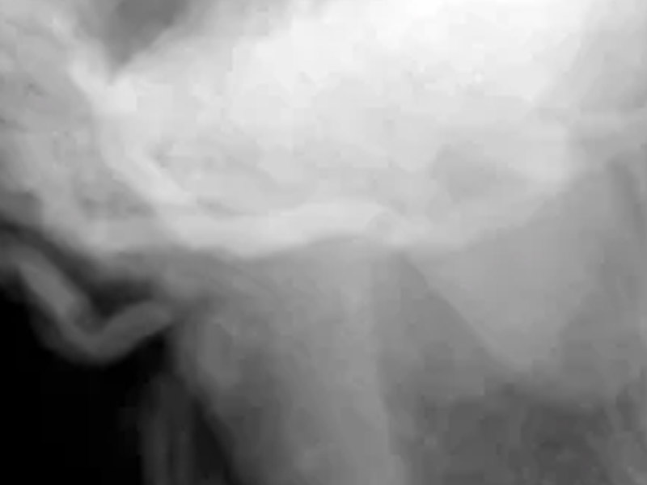

# Ptychography reconstruction package “ptypy” now available online

Our [ptychography](../../research.md) reconstruction package **ptypy** is now open-source and [online](https://github.com/ptycho/ptypy/releases)!

<!-- more -->

The package has come a long way since its debut at the [cSAXS beamline](https://www.psi.ch/en/sls/csaxs) at the Swiss Light Source. The difference map reconstruction algorithm was first implemented in MATLAB with contributions from Martin Dierolf, Andreas Menzel and Cameron Kewish. Its descendant is still in used by the cSAXS group, with large improvements by Manuel Guizar-Sicairos, Ana Diaz, and co-workers.

The Python version has evolved over a few years in [Franz Pfeiffer’s group](https://www.ph.nat.tum.de/en/e17/home/), with important contributions from Marco Stockmar, Björn Enders, Benedikt Daurer, Philipp Pelz, as well as feedback and bug reports from many others. In 2013, we have started a complete redesign of the code, which got completed only in mid-2014, thanks mostly to Björn’s huge effort. The new modular and object-oriented design will make maintenance and upgrades much easier.

Among the cutting-edge features already implemented:

- Fully parallelized (using MPI)
- Difference map algorithm with power bound constraint
- Maximum Likelihood with preconditioners and regularizers
- Mixed-state reconstructions of probe and object
- On-the-fly reconstructions (while data is being acquired)

With its open-source release, we hope that the package will find a stable user base. Bug reports, enhancement requests and, of course, contributions are very welcome!

[Back to all news](../index.md)
