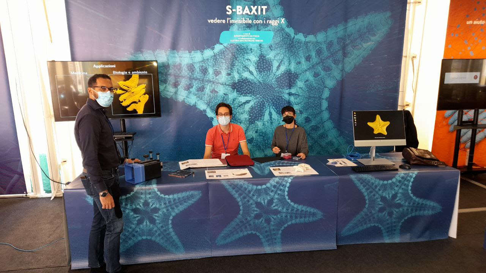

# S-BaXIT at Trieste Next

We participated in this year’s [Trieste Next](https://www.triestenext.it) and [Sharper Night](https://www.sharper-night.it/sharper-trieste/), two public outreach events taking place on Trieste’s central square, Piazza Unità d’Italia, from 24-26.09.21.

<!-- more -->

As you can tell from the picture, this year’s theme were starfishes (of recent [media fame](a-starfish-in-the-news.md)). Besides a video slideshow and posters, we showed 3D prints of sample reconstructions, a tomography demonstration toy, and an interactive visualization of 3D models.

Thanks to everybody who came to visit and see you next year!

[Back to all news](../index.md)
