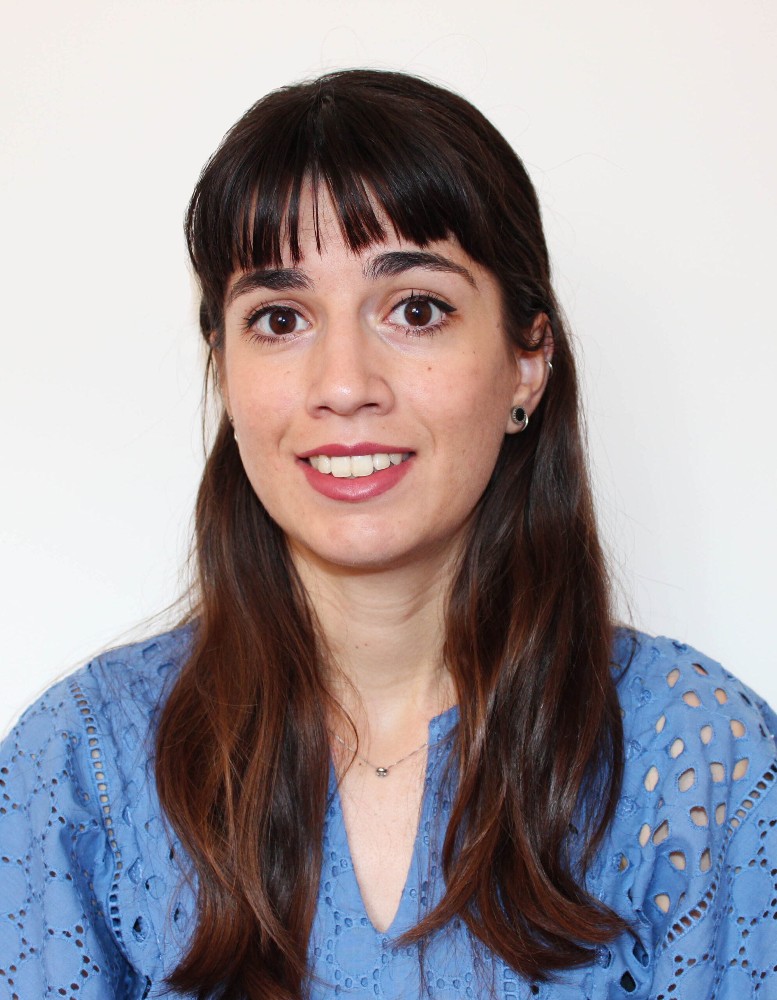

# Sara joins the group!

Sara Savatović is the first PhD student to join the group. She is originally from Pula, Croatia, and just completed her MSc in Nuclear and Subnuclear Physics (2020) at the [University of Trieste](https://df.units.it/en). Her master’s project was on a Monte-Carlo simulation of a medical linear accelerator in Geant4.

<!-- more -->

Sara will be working on [speckle-based X-ray imaging and tomography](../../research.md), with a special focus on dark-field imaging in biomedical applications.

[Back to all news](../index.md)
