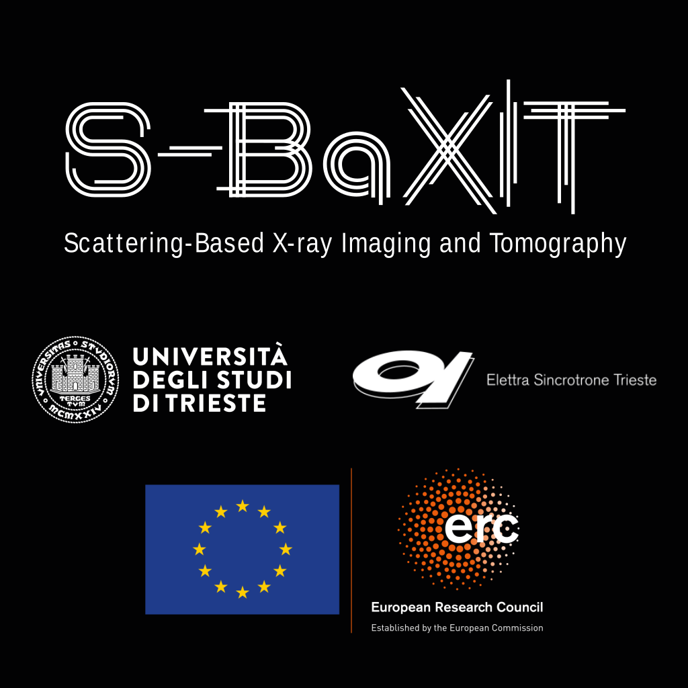

# The S-BaXIT project begins!

Today is the start of Prof. Thibault’s ERC Consolidator Grant project [“Scattering-Based X-ray Imaging and Tomography” (S-BaXIT)](https://cordis.europa.eu/project/id/866026), with the [University of Trieste](https://df.units.it/en) as the host and the [Synchrotron Elettra](https://www.elettra.eu/) as a partner. With a budget of €2.2M over 5 years, the project will [push the limits of X-ray imaging](../../research.md) by attempting to extract as much information as possible from scattering phenomena.

<!-- more -->

[Back to all news](../index.md)
