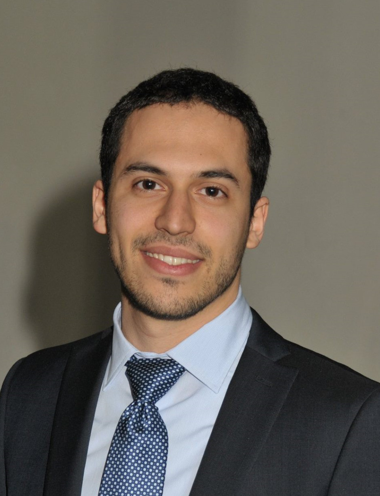

# Vittorio joins the team!

Dr. Vittorio Di Trapani, who just completed his PhD at the University of Siena, is joining the team today as a post-doc. Vittorio has vast experience with X-ray imaging, both at synchrotron facilities and in the lab. His expertise will be invaluable to push ahead the dark-field tomography project.

<!-- more -->

[Back to all news](../index.md)
