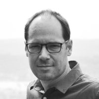
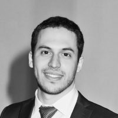
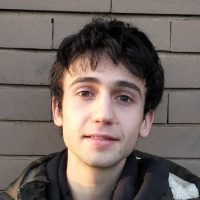
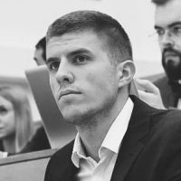
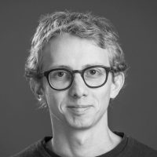

# Our team

Members of the OptImaTo group working on the S-BaXIT project

### Pierre Thibault

{ .portrait }

Group leader

Pierre is originally from Québec, Canada. After completing his PhD in Cornell University he was researcher at PSI (Switzerland), at TUM (Germany), then lecturer at UCL and associate professor at the University of Southampton.. He is now full professor at the University of Trieste, working on the development of high-resolution X-ray imaging techniques. Most of Pierre’s research work has been supported by the European Research Council, first with the starting grant “OptImaX” (2011-2017) and since 2020 with the consolidator grant “S-BaXIT”.

Contact

Email: pthibault [at] units [dot] it

ORCID:  <https://orcid.org/0000-0003-1278-8846>

### Vittorio Di Trapani

{ .portrait }

Postdoc

Vittorio is originally from Palermo, Italy. He completed a bachelor’s degree in Physics (2015) and a master’s degree in Medical Physics (2017) at the University of Pisa (Italy). His master’s degree thesis concerned the characterization of a system for breast-CT with synchrotron radiation implemented within the SYRMA-3D collaboration at the SYRMEP beamline of Elettra synchrotron. In 2017 he started a PhD course in experimental Physics at the University of Siena (Italy). His PhD project focused on the implementation of two state-of-the-art acquisition systems for spectral imaging applications. The first system was a lab-setup for spectral micro-CT including an energy resolving photon counting detector, the second was a setup for K-edge imaging with bent-Laue optics at synchrotron sources. As part of his PhD program, he spent six months as visiting researcher at the University of Saskatchewan (Saskatoon, Canada), collaborating with Prof. D. Chapman in the development of acquisition procedures and reconstruction algorithms tailored for spectral imaging with bent-Laue crystals.
After defending his PhD thesis in May 2021, Vittorio joined the S-BaXIT project in July 2021. His main interest is in the development of a setup for conventional transmission micro-CT for scattering signal extraction.

Contact

Email: vittorio [dot] ditrapani [at] units [dot] it

Phone: +39 040 375 8994

### Marcello Fonda

{ .portrait }

PhD Student

Marcello is originally from Trieste, Italy. He graduated with honors as Master of Science in Physics at the University of Trieste (Trieste,Italy) with a thesis on X-ray spectral imaging implemented with photon counting detectors and model-based algorithms. Marcello is currently a PhD student at the University of Trieste, his scholarship, funded by S-BaXIT project, focuses on bridging the gap between lab-based and synchrotron techniques for spectral and phase-contrast imaging and tomography.

Contact

Email: marcello [dot] fonda [at] phd [dot] units [dot] it

ResearchGate: <https://www.researchgate.net/profile/Marcello-Fonda>

Linkedin: <https://www.linkedin.com/in/marcellofonda/>

### Giovanni Lemma

{ .portrait .grayscale }

PhD Student

Giovanni is originally from Ravenna, Italy. He graduated with honors as Master of Science in Physics at the University of Trieste (Trieste,Italy) with a thesis on X-ray phase-contrast and dark-field imaging and tomography implemented with modulation-based technique. Giovanni is currently a PhD student at the University of Trieste, his scholarship, funded by S-BaXIT project, focuses on scattering-based imaging and tomography techniques.

Contact

Email: giovanni [dot] lemma [at] phd [dot] units [dot] it

ResearchGate: <https://www.researchgate.net/profile/Giovanni-Lemma>

Linkedin: <https://www.linkedin.com/in/giovanni-lemma-a7b6b1338/>

### Melissa Amati

{ .portrait }

Project manager

Contact

Email: mamati [at] units [dot] it

Phone: +39 040 558 2960

## Close collaborators

Other participants contributing to the S-BaXIT effort

### Irene Zanette

{ .portrait }

### Stevan Vrbaski

{ .portrait }

### Benedikt Daurer

{ .portrait }

## Alumni

Past group members of the Thibault research group, including in previous institutions.

- Fabio De Marco

- Sara Savatović

- Marco Margini

- Ginevra Lautizi

- Marie-Christine Zdora

- Ronan Smith

- Sharif Ahmed

- Hans Deyhle

- Simone Sala

- Stefanos Chalkidis

- Charan Kuppili
