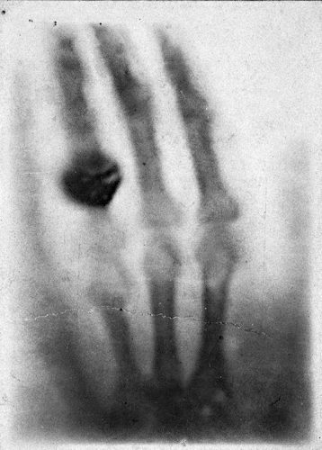
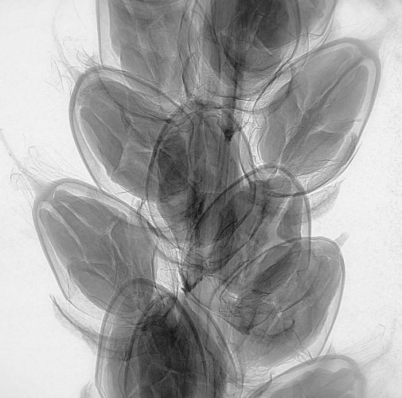
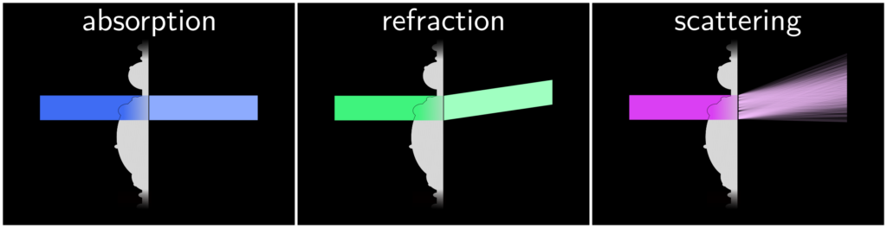
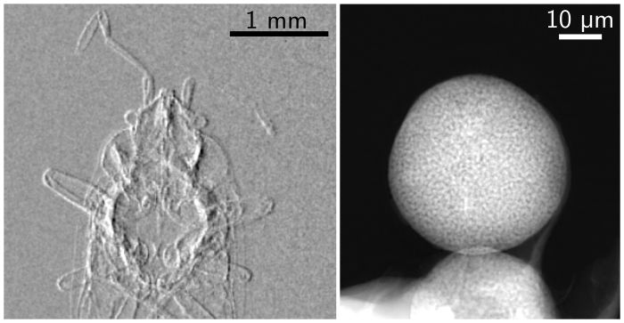
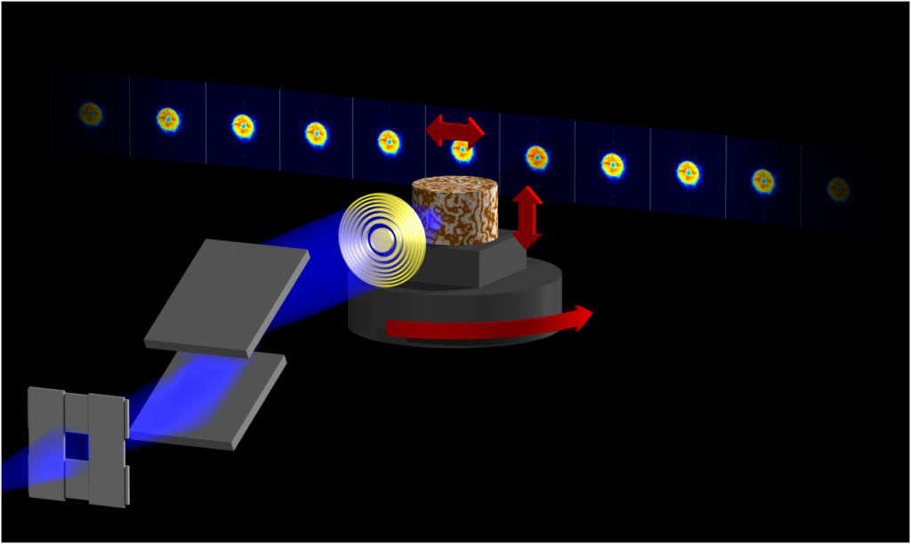
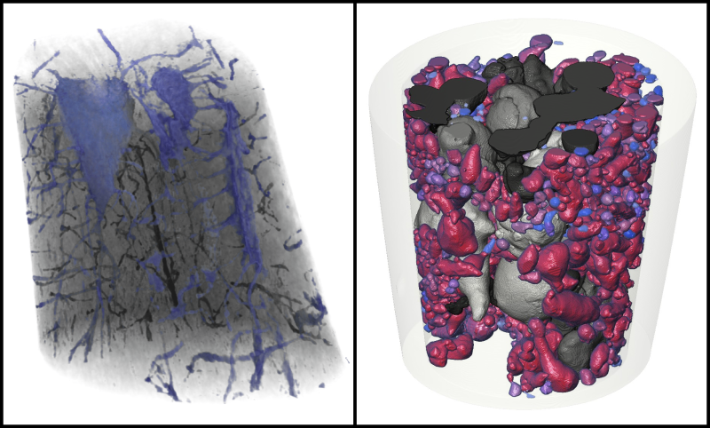

# Research

Our group develops new techniques to exploit some of the unique characteristics of X-ray radiation. We are especially interested in X-ray coherence and X-ray scattering.

[PtyPy](https://ptycho.github.io/ptypy/){ .md-button }
[UMPA](https://github.com/optimato/UMPA){ .md-button }

## X-rays for science

X-rays have attracted the fascination of the general public since their discovery 125 years ago. They are now used for a broad range of applications. Beyond the well-known medical CT scans and airport security screening, X-rays are used in all fields of science and technology to see what would otherwise be invisible.

 

The hand of Anna Berthe Röngten, the very first X-ray radiograph, done on the 22 December 1895.

 

X-ray radiograph of the fruits of a broadleaf plantain (Plantago major)

## New X-ray imaging modalities

Normally, X-ray images are absorption maps of the sample they travel through. Like any other type of light, X-rays can also be refracted, though by only small angles. X-rays can also be scattered, typically by structures on a length scale similar to the X-ray wavelength – that is, down to the atomic scale!

 

X-ray contrast mechanisms. Absorption (in blue) appears as a weakening of the incident beam intensity. Refraction (in green) is a deviation of the X-ray beam caused by the sample. Scattering (in purple) is a dispersion of the incident X-rays caused by small-scale structure in the sample.

The main contrast mechanisms available to X-ray scientists are depicted here. Absorption, the most common, is observed as a decrease of intensity caused by the interaction of the X-rays with the sample. X-rays can change direction while traveling through matter, a phenomenon known as refraction. This effect is normally very weak, but is nevertheless important because it produces better images of low-density samples. Finally, scattering is the “messy” mechanism that contains all the rest of the physics: coherent and incoherent interaction with nanometer-scale variations in the sample.

Because refraction can be explained as a change in the phase velocity of the X-rays through matter, imaging methods that rely on refraction are called “phase-contrast” methods. Compared to absorption, which is readily observed with any X-ray detector, phase-contrast requires ingenious techniques to capture the small deviations in the incident X-ray wavefront.

Phase-sensitive X-ray methods excel when the variation in density are small, like in animal soft tissues. It is also an invaluable tool when there is a need for quantitative imaging: when we want to know not only if one part of a sample is denser, then another, but precisely by how much. By now, many strategies have been devised to measure such signal. On the right, results from two methods developed by our group: speckle-based imaging[^1], and ptychography[^2].

 

Two examples of phase-contrast images. On the left, a differential phase contrast image of an insect (Orius Niger) where darker and brighter values indicate rightward and leftward refraction, respectively. On the right, the phase image of a porous sphere, where brighter pixels indicate a stronger phase shift.

## Scattering-aware X-ray imaging

The research project S-BaXIT (Scattering-Based X-ray Imaging and Tomography) funded by the European Research Council, aims at bringing X-ray scattering mechanisms fully into the context of imaging, and to develop and apply techniques that exploit scattering through new measurement strategies.

We work on scattering-aware imaging modalities that can reveal features that could not be seen before. We will use these methods for a broad range of applications, from advanced materials to fragile biological samples, to valuable heritage and archaeological artifacts.

Our favorite strategy is to exploit “measurement diversity”: the idea of taking multiple measurements while some well-controlled experimental parameters are changed. The resulting datasets contain redundant information that is then algorithmically decoded. The two experimental methods that form the starting point of our exploration are ptychography and speckle-based X-ray imaging.

## Ptychography

Ptychography is a lensless imaging technique that can produce extremely high resolution images – down to the nanometer with X-rays, and below the atomic scale with electrons. This technique requires the high-quality X-rays that can be obtained almost exclusively in large synchrotron radiation facilities. First developed in the 70s to improve the resolution of transmission electron microscopy, it has had tremendous success within the last decade as a X-ray microscopy technique.

 

Schematic representation of a ptychography experiment: diffraction patterns are collected as a sample is translated and rotated in a narrow X-ray beam.

A ptychographic dataset is a collection of multiple diffraction patterns measured while the sample is translated and rotated in a fixed X-ray illumination. The distribution of the scattered X-rays contains the high-resolution information required to reconstruct the sample image[^3].

Our group works on data analysis tools and reconstruction algorithms to solve ptychographic problems. One of the successful methods is the difference map[^4], a meta-algorithm that can solve a wide variety of constraint-based problems. Another method, most often used as a refinement step, is based on maximum likelihood principles [^5]. Both methods have been implemented in our open-source Python package [ptypy](http://ptycho.github.io/ptypy)[^6].

 

Two examples of ptychographic nano-CT

The extension of the technique to three dimensions appeared soon after its demonstration in 2D. Our group was part of the pioneering team for ptychographic nano-CT[^7], and is still active in the development and improvement of the technique[^8].

## Speckle-based X-ray imaging

Speckle-based imaging (SBI) is sensitive to the disturbances caused by a sample on the incident X-rays, beyond simple absorption. The key idea is to use a patterned X-ray illumination, whose deformations are analysed to extract information from a sample[^9].

<video controls muted loop playsinline preload="metadata" src="assets/videos/flower-bud-speckle-imaging.mp4" aria-label="Speckle-based X-ray imaging measurement"></video>

An example measurement in shown on the left. A patterned illumination – here simply produced by placing a piece of sandpaper in the X-ray beam – is shifted around in the field of view. Refraction caused by the sample causes distortions in the speckle pattern. The Unified Modulation Pattern Analysis (UMPA) is an algorithmic method developed by our group to extract the refraction angles from these measurements[^10]. In addition to refraction, also called differential phase-contrast, an attenuation and a scattering images are also extracted (not shown on this image).

Our laboratory at Elettra hosts a liquid-metal-jet X-ray source, where speckle-based imaging will be further developed and applied to a broad range of samples.

[^1]: M.-C. Zdora, I. Zanette, T. Walker, N. W. Phillips, R. Smith, H. Deyhle, S. Ahmed and P. Thibault, [X-ray phase imaging with the unified modulated pattern analysis of near-field speckles at a laboratory source](https://doi.org/10.1364/AO.384531), **Appl. Opt.** (2020) |

[^2]: P. Thibault and M. Guizar-Sicairos, [Maximum-likelihood refinement for coherent diffractive imaging](http://doi.org/10.1088/1367-2630/14/6/063004), **New J. Phys.** (2012) |

[^5]: P. Thibault and M. Guizar-Sicairos, [Maximum-likelihood refinement for coherent diffractive imaging](http://doi.org/10.1088/1367-2630/14/6/063004), **New J. Phys.** (2012) |

[^3]: P. Thibault, M. Guizar-Sicairos and A. Menzel, [Coherent imaging at the diffraction limit](http://doi.org/10.1107/S1600577514015343), **J. Synchrotron Radiat.** (2014) |

[^4]: P. Thibault, M. Dierolf, A. Menzel, O. Bunk, C. David and F. Pfeiffer, [High-Resolution Scanning X-Ray Diffraction Microscopy](http://doi.org/10.1126/science.1158573), **Science** (2008) |

[^6]: B. Enders and P. Thibault, [A computational framework for ptychographic reconstructions](http://doi.org/10.1098/rspa.2016.0640), **P. Roy. Soc. A-MathA-math. Phy.** (2016) |

[^7]: M. Dierolf, P. Thibault, A. Menzel, C.M. Kewish, K. Jefimovs, I. Schlichting, K. König, O. Bunk and F. Pfeiffer, [Ptychographic coherent diffractive imaging of weakly scattering specimens](http://doi.org/10.1088/1367-2630/12/3/035017), **New J. Phys.** (2010) |

[^8]: I. Zanette, B. Enders, M. Dierolf, P. Thibault, R. Gradl, A. Diaz, M. Guizar-Sicairos, A. Menzel, F. Pfeiffer and P. Zaslansky, [Ptychographic X-ray nanotomography quantifies mineral distributions in human dentine](http://doi.org/10.1038/srep09210), **Sci. Rep.** (2015) |

[^9]: I. Zanette, T. Zhou, A. Burvall, U. Lundström, D. H. Larsson, M. Zdora, P. Thibault, F. Pfeiffer, and H. M. Hertz, [Speckle-Based X-Ray Phase-Contrast and Dark-Field Imaging with a Laboratory Source](http://doi.org/10.1103/PhysRevLett.112.253903), **Phys. Rev. Lett.** (2014) |

[^10]: M.-C. Zdora, P. Thibault, T. Zhou, F. J. Koch, J. Romell, S. Sala, A. Last, C. Rau and I. Zanette, [X-ray Phase-Contrast Imaging and Metrology through Unified Modulated Pattern Analysis](http://doi.org/10.1103/PhysRevLett.118.203903), **Phys. Rev. Lett.** (2017) |
